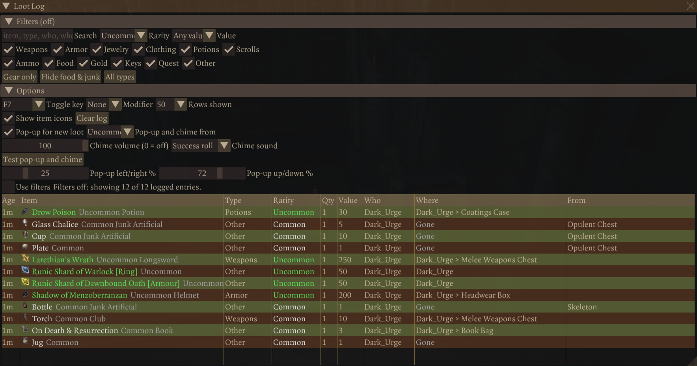

# Loot Log

Logs all loot your party gets, also from auto-loot mods, in a filterable in-game window with an optional pop-up and chime.

## What it does

- Logs every item that joins the party: the inventories of the party members, the bags inside them, and the camp
  chest.
- Works with auto-loot mods, because it listens to the game's inventory events instead of the loot window.
- An in-game window lists the log, with filters for item type, rarity, value and a text search.
- Shows where each item is now: which party member, which bag, the camp chest, or sold and gone. Items that sorting
  mods move into bags are easy to find again.
- A pop-up and a chime tell you about new loot of the rarity you choose (Uncommon and better by default).
- Each savegame keeps its own log (the newest 500 entries).

## Screenshots



## How to install

1. Install [Norbyte's Script Extender](https://github.com/Norbyte/bg3se). It updates itself.
2. Download `bg3_lootlog.pak` from the latest release on GitHub.
3. Copy it to `%LOCALAPPDATA%\Larian Studios\Baldur's Gate 3\Mods`.
4. Enable **Loot Log** in your mod manager (BG3 Mod Manager or the in-game mod manager).

To update the mod, replace the `.pak` with the one from the new release. To remove it, disable it in the mod manager
and delete the `.pak`. Saves made with the mod can then show a warning about a missing mod.

## How to use

Press **F7** to show or hide the window. You can change the key and add a modifier (Ctrl, Shift, Alt) under
**Options**.

- **Filters**: item types (12 checkboxes), minimum rarity, minimum value (gold), and a search over the item name,
  type, owner (*Who*), current place (*Where*) and source (*From*). A search for a bag name lists everything in that
  bag. The section folds; its header says *Filters (active)* when a filter hides entries.
- **Quick buttons**: *Gear only* (weapons, armor, jewelry), *Hide food & junk*, *All types*.
- **Use filters** (the checkbox right above the table): turn it off to see the full log with one click. Your filter
  settings stay as they are. The status line then reads *Filters off*, and the section header *Filters (off)*.
- **Options**: toggle key, modifier, rows shown, item icons, and *Clear log*.
- **Pop-up and chime**: new loot of at least the chosen rarity shows a notice for 6 seconds (name and subtext, newest
  first, at most 5 lines) and plays a chime. The notice does not catch mouse clicks. Options: *Pop-up for new loot*,
  *Pop-up and chime from* (rarity, default *Uncommon+*), *Pop-up left/right %* and *Pop-up up/down %* (default 50 / 14,
  top center; moving a slider shows a sample), *Chime volume* (0 = off; releasing the slider plays a preview), *Chime
  sound* (Item received, Recipe unlocked, Success roll, Inspiration, Coins, Journal updated, Quest completed, Dice
  success) and *Test pop-up and chime*.

Every item shows a subtext like the game's tooltip, for example *Uncommon Cloak*, *Rare Longsword*, *Common Light
Armour*, *Common Potion*. The search also finds the type ("cloak", "ring").

The **Where** column shows where the item is now:

- *Karlach*, *Karlach > Pouch > Gem Bag* (bags inside bags), *Karlach (equipped)*, *Camp chest > Box*
- in gray: another inventory (a trader after you sold the item, or a chest in the world), *On the ground*, or *Gone*
  (sold, used up or destroyed; this is final)
- a potion, arrow or gold stack that merged into another stack shows the place of that stack

While the window is open, the places are checked every 2 seconds.

### Columns

| Column | Meaning |
|--------|---------|
| Age | Time since the item arrived (real time) |
| Item | Item name, colored by rarity, followed by the subtext (rarity and item type) |
| Type | Weapons, Armor, Jewelry, Clothing, Potions, Scrolls, Ammo, Food, Gold, Keys, Quest, Other |
| Rarity | Common, Uncommon, Rare, Very Rare, Legendary, Unique |
| Qty | Stack size |
| Value | Value of one item, in gold |
| Who | Party member (or *Camp chest*) that received the item |
| Where | Where the item is now |
| From | Container, corpse or trader the item came from; empty for items picked up from the ground |

### Console commands (Script Extender console)

| Command | Effect |
|---------|--------|
| `!lootlog` | Show or hide the window |
| `!lootlog_test` | Add one sample entry per item type (to check the window without looting) |
| `!lootlog_debug` | Print every relevant inventory event to the console (on/off) |
| `!lootlog_rescan` | Mark everything the party owns as known again |

The filter, window, pop-up and chime settings are saved in
`%LOCALAPPDATA%\Larian Studios\Baldur's Gate 3\Script Extender\bg3_lootlog\settings.json`. The log itself is saved in
the savegame.

## Compatibility

- Game version: Patch 8
- The load order does not matter. The mod changes no game data; it only reads the game's inventory events.
- **Ancient Mega Pack auto loot** works: it moves loot without notifications, and Loot Log still logs it. Corpse and
  chest loot shows the corpse or chest in *From*; ground pickups have no source; picked-up containers are listed with
  their contents; *send to camp* changes the owner to *Camp chest*.
- **Loot Autoseller** (FallenStar) works: junk is sold the moment it arrives. It still appears in the log as *Other*,
  followed by a small *Gold* entry. *Hide food & junk* and the *Gold* checkbox hide both.
- No known conflicts.

## Known issues

- Splitting a stack creates a new item. A split stack (also gold) that moves to another party member can appear as
  new loot.
- Dropping an item and picking it up again logs it again, because the game creates a new item on pickup.
- Items the party owned before the mod was installed are never logged.
- While the chime plays, other UI sounds are quieter too: the chime volume scales the game's UI volume for a moment.

If the window does not open, look for errors in the Script Extender console. To turn the console on, create
`ScriptExtenderSettings.json` in the game's `bin` folder:

```json
{
  "CreateConsole": true,
  "LogRuntime": true
}
```

After each load, the console shows a line like
`[LootLog] Loot Log 1.0.0.0. Session loaded: 4 party members, 812 items marked as known, 37 log entries. Logging is active.`

## How to build

Anyone can build this mod from its source code and check that the download matches it.

1. Install the tools: Windows PowerShell 5.1 (part of Windows) and [LSLib](https://github.com/Norbyte/lslib/releases)
   v1.20.4. Put LSLib into a folder `_tools\lslib\` above the repository, or set `BG3_TOOLS` to the folder that holds
   `lslib\`.
2. Build it: `powershell -ExecutionPolicy Bypass -File .\build.ps1`
3. Find the file: `dist\bg3_lootlog.pak`

The offline tests need Python 3 with lupa: `python -m pip install lupa`, then `python tests\run_tests.py`.

## Credits

Made by Kintaro. MIT license: you may use, change and share this mod.
